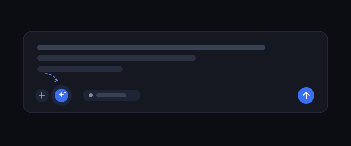

# dsh-session-prompt-optimizer

[中文说明](README.zh.md) · MIT · a plugin for [DeepSeek Harness](https://github.com/deepseek-ai/dsh)

One button in the composer. It takes the draft you have typed, rewrites it into a
clearer instruction for the agent, and shows both versions side by side above the
composer. Your text is only replaced when you say so.

## Install

```sh
dsh plugin --profile web add github:markmuteki/dsh-session-prompt-optimizer
```

or from npm:

```sh
dsh plugin --profile web add dsh-session-prompt-optimizer
```

Restart `dsh web` after installing. No configuration is needed.

## Use

| Gesture | Result |
| --- | --- |
| Click | Rewrite the draft, close to its original length and shape |
| Shift+click | Structured rewrite: goal, then context and constraints, then the finished result |
| Alt+click | Compress: same intent, fewer words |

The button sits left of the model chip. It is disabled while the composer is empty,
while a message is being sent, and while a rewrite is already running.

A finished rewrite opens a card just above the composer with the draft on the left
and an editable result on the right: **Use this** writes it into the composer,
**Copy** leaves the composer alone, **Dismiss** closes the card. If you kept typing
while the request was running, the card says so instead of overwriting the newer text.

## What it keeps

- Every intent, fact, path, name, number, version and constraint already in the draft.
  It is not allowed to invent a requirement.
- The language of the draft: Chinese stays Chinese, English stays English.
- Code, commands, paths, URLs and quoted strings, copied verbatim.

It drops pleasantries and framing, leads with the task, and replaces vague verbs with
the concrete action. A draft that is already a good prompt is left nearly alone.

## It reads the session it rewrites for

A draft written into a running conversation is rarely self-contained. Each rewrite is
given a bounded excerpt of the session: at most six recent messages (600 characters
each, about 2,400 in total), the session title and active goal, and the workspace
directory. The excerpt is only read — the plugin adds no messages to the session and
persists nothing beyond its own template cache.

## Cost and privacy

One extra model request per click, on the model the composer is set to, with reasoning
effort pinned to its lowest level. The draft and that excerpt go to the same model that
would receive the message itself. Nothing else is sent anywhere except the upstream
release check described below (a plain HTTPS request to GitHub).

## Where the instructions come from

The rewrite instructions are the `user-optimize` templates of the open-source
[prompt-optimizer](https://github.com/linshenkx/prompt-optimizer) project, not text
written inside this plugin:

| Mode | Template |
| --- | --- |
| Click | User prompt basic optimization |
| Shift+click | Step-by-step planning |
| Alt+click | Basic optimization plus a brevity rule |
| `mode: "professional"` (API only) | Professional optimization |

A background check reads that project's latest release shortly after the harness starts
and then every six hours, validates the six templates (Chinese and English) and caches
them in `.state/upstream.json`. New templates are picked up on the next click; no
restart and no install. Offline, the cached copy is used, falling back to the built-in
prompt. `GET /_prompt-optimizer/health` reports the release being followed and
`POST /_prompt-optimizer/refresh` forces a check.

## Limits

- Accepting replaces the whole draft: inline reference chips become `@path` text.
- Slash commands are refused, since rewriting one would break it.
- Drafts longer than 12,000 characters are refused.
- One rewrite at a time per session.
- The host gives up after 45 seconds, the client after 90.
- Web platform only.

## Development

| File | Role |
| --- | --- |
| `index.js` | Host half: the three same-origin routes and the model call |
| `client.js` | Browser half: the button, the card, `setDraft` |
| `context.js` | Builds the bounded session excerpt |
| `upstream.js` | Fetches, validates and caches the upstream templates |
| `docs/DETAIL.md` | Longer notes on behaviour and design |

`node _prompt_check.mjs` runs a local check of the prompt assembly.

## License

MIT © markmuteki. The rewrite templates come from
[linshenkx/prompt-optimizer](https://github.com/linshenkx/prompt-optimizer), which is
distributed under its own license.
