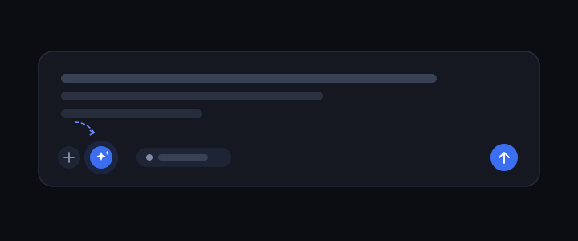

# dsh-composer-prompt-optimizer

[English](README.md) · MIT · [DeepSeek Harness](https://github.com/deepseek-ai/dsh) 插件

输入框里多一个按钮：它把你刚写好的草稿改写成更清楚的指令，然后把原文和改写结果并排放在
输入框上方。只有你点确认，输入框里的字才会被替换。

## 安装

```sh
dsh plugin --profile web add github:markmuteki/dsh-composer-prompt-optimizer
```

或者从 npm：

```sh
dsh plugin --profile web add dsh-composer-prompt-optimizer
```

装完重启 `dsh web`。不需要任何配置。

## 用法

| 操作 | 结果 |
| --- | --- |
| 单击 | 改写草稿，长度和结构尽量贴近原文 |
| Shift+单击 | 结构化改写：先目标，再上下文与约束，最后是成品要求 |
| Alt+单击 | 压缩：保留意图，减少字数 |

按钮在模型选择器左侧，输入框为空、消息正在发送、或已有改写正在排队时不可用。

改写完成后，输入框上方会展开一张对照卡：左边是你的草稿，右边是可以继续编辑的结果。
**使用** 把它写进输入框，**复制** 只复制不动输入框，**关闭** 收起卡片。如果请求期间你
又改了草稿，卡片会提示这一点，不会悄悄覆盖你新写的字。

## 它会保留什么

- 草稿里已有的每个意图、事实、路径、名字、数字、版本号和约束。它不允许凭空增加需求。
- 草稿的语言：中文还是中文，英文还是英文。
- 代码、命令、路径、链接和引号里的内容，原样照抄。

它会去掉客套和铺垫，让任务本身排在前面，把含糊的动词换成具体动作。本来就写得好的草稿
几乎不会被改动。

## 它会读这条会话

写进一段正在进行的对话里的草稿，往往并不自足。所以每次改写都会带上这条会话的一小段
上下文：最近最多 6 条消息（每条 600 字，合计约 2,400 字）、会话标题与当前目标、工作区
目录。这段上下文只读不写——插件不会往会话里加消息，除了自己的模板缓存也不落盘。

## 成本与隐私

每次点击多发一次模型请求，用的是输入框里选中的模型，推理档位压到该模型声明的最低档。
发送的内容只有你的草稿和上面那段会话摘录，收件人就是本来会收到这条消息的那个模型。
除此之外只有下面说的上游版本检查（一个普通的 GitHub HTTPS 请求）。

## 改写指令从哪来

改写指令是开源项目 [prompt-optimizer](https://github.com/linshenkx/prompt-optimizer)
的 `user-optimize` 模板，不是本插件里手写的：

| 模式 | 模板 |
| --- | --- |
| 单击 | User prompt basic optimization |
| Shift+单击 | Step-by-step planning |
| Alt+单击 | 基础优化 + 简洁规则 |
| `mode: "professional"`（仅 API） | Professional optimization |

插件启动后不久会读一次该项目的最近发布，之后每六小时一次，校验中英各六份模板并缓存到
`.state/upstream.json`。有新版本时下一次点击就会用上，不需要重启或安装。离线时用缓存；
从下载成功过就给内置提示词。`GET /_prompt-optimizer/health` 报告当前跟随的发布版本，
`POST /_prompt-optimizer/refresh` 立即检查一次。

## 限制

- 确认会整体替换草稿：行内引用小卡片会变成 `@路径` 纯文本。
- 斜杠命令会被拒绝——改写它会让命令失效。
- 超过 12,000 字的草稿会被拒绝。
- 同一条会话同时只允许一次改写。
- 服务端 45 秒、客户端 90 秒后放弃。
- 只支持 Web 平台。

## 开发

| 文件 | 作用 |
| --- | --- |
| `index.js` | 宿主侧：三个同源路由与模型调用 |
| `client.js` | 浏览器侧：按钮、对照卡、`setDraft` |
| `context.js` | 拼装受限的会话摘录 |
| `upstream.js` | 抓取、校验并缓存上游模板 |
| `docs/DETAIL.zh.md` | 更详细的行为与设计说明 |

`node _prompt_check.mjs` 会跑一遍提示词拼装的本地检查。

## 许可

MIT © markmuteki。改写模板来自
[linshenkx/prompt-optimizer](https://github.com/linshenkx/prompt-optimizer)，按该项目
自己的许可分发。
